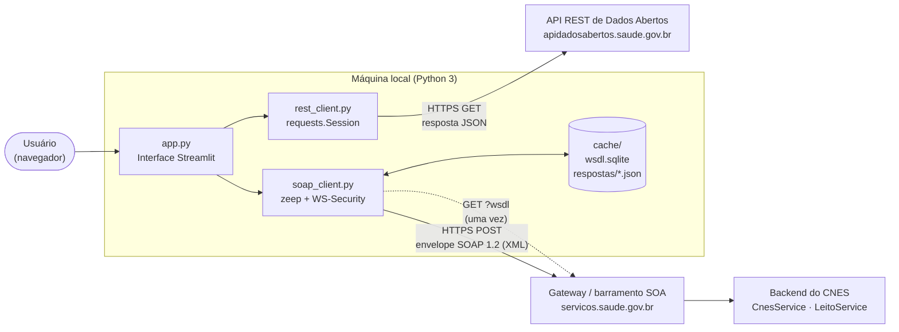

# Monitor de Estabelecimentos de Saúde (CNES)

Trabalho da disciplina de **Sistemas Distribuídos**: consumo, na prática, de dois Web Services públicos e reais do Ministério da Saúde, um **REST (JSON)** e um **SOAP (XML/WSDL)**, integrados em um único sistema que também compara os dois.

O usuário escolhe um município. A **API REST** de Dados Abertos da Saúde lista os estabelecimentos de saúde (hospitais, UBS, clínicas...). O usuário escolhe um deles e o **Web Service SOAP** do barramento do CNES traz os dados oficiais: dados cadastrais, leitos (totais e SUS) e profissionais por ocupação. A interface mostra também o tempo e o tamanho de cada resposta, as mensagens trocadas (JSON e envelopes XML) e um benchmark entre os dois protocolos.

**Motivação.** O CNES (Cadastro Nacional de Estabelecimentos de Saúde) é a base oficial da infraestrutura de saúde do país. Consultar quantos leitos um hospital tem, quantos deles são do SUS e que tipo de unidade atende em cada bairro é informação de interesse público: ajuda a enxergar onde está a rede de atenção básica (UBS), onde estão os leitos de internação e como ela se distribui entre os municípios. O projeto usa essas fontes oficiais e abertas para esse monitoramento e, ao mesmo tempo, compara dois estilos de integração que convivem no próprio governo.

### Itens exigidos pelo enunciado

| Item | Onde está |
|---|---|
| a) Links das documentações oficiais das APIs | [REST](#item-a-rest) · [SOAP](#item-a-soap) · [Referências](#referencias) |
| b) Link direto do arquivo `.wsdl` | [Seção 6.1](#item-b) |
| c) Exemplo real do JSON recebido pela aplicação REST | [Seção 5.5](#item-c) · [`exemplos/resposta_rest.json`](exemplos/resposta_rest.json) |
| d) Exemplo real do XML recebido pela aplicação SOAP | [Seção 6.5](#item-d) · [`exemplos/`](exemplos/) |
| Código-fonte REST + execução | [`rest_client.py`](rest_client.py) · [Seção 5.4](#rest-codigo) · [Como executar](#como-executar) |
| Código-fonte SOAP + execução | [`soap_client.py`](soap_client.py) · [Seção 6.7](#soap-codigo) · [Como executar](#como-executar) |

---

## Sumário

1. [Integrantes](#integrantes)
2. [Arquitetura](#arquitetura)
3. [Tecnologias e estrutura de pastas](#tecnologias)
4. [Como executar](#como-executar)
5. [Serviço REST — API de Dados Abertos da Saúde](#rest)
6. [Serviço SOAP — barramento do CNES (DATASUS)](#soap)
7. [Comparação REST x SOAP](#comparacao)
8. [Dificuldades encontradas e soluções](#dificuldades)
9. [Testes automatizados](#testes)
10. [Conclusões](#conclusoes)
11. [Referências](#referencias)

---

<a id="integrantes"></a>
## 1. Integrantes

- Sarah Emanuelle Alves Lino
- Tainara Ribeiro Santos

---

<a id="arquitetura"></a>
## 2. Arquitetura



**Fluxo de uma consulta:**

1. O `app.py` (Streamlit) chama `rest_client.listar_estabelecimentos()`. O cliente faz um `GET` com filtros na *query string* e recebe um JSON.
2. O usuário escolhe um estabelecimento. O `app.py` chama `rest_client.buscar_estabelecimento()`, `soap_client.consultar_estabelecimento()` e `soap_client.consultar_leitos()`. As chamadas são independentes: se o SOAP falhar, o REST continua funcionando, e vice-versa.
3. O `soap_client` usa clientes `zeep` montados a partir dos WSDLs, carregados **uma vez** e guardados em `cache/wsdl.sqlite`. Cada operação é um `POST` com um envelope SOAP 1.2 que leva no cabeçalho o usuário e a senha (WS-Security).
4. O pedido passa por um **gateway** em `servicos.saude.gov.br`, que encaminha ao backend do CNES. Há dois indícios de que é um Oracle Service Bus/WebLogic: os erros de autenticação vêm com o código `OSB-386200`, e toda resposta traz um cabeçalho `WorkContext` do WebLogic. É nesse gateway que acontecem os `504 Gateway Timeout` descritos na [seção 8](#dificuldades).
5. Toda resposta SOAP bem-sucedida é salva em `cache/respostas/`. Se o servidor falhar depois de todas as tentativas, a última resposta salva é exibida, com um aviso e a data em que foi obtida.

**A interface (`app.py`):**

- **Barra lateral:** município (10 capitais ou qualquer código IBGE), tipo de unidade (carregado do REST; o padrão é *Hospital Geral*), somente ativos, itens por página, status dos dois serviços (🟢/🔴, verificado a cada 60 s) e um *modo demonstração*, que simula o SOAP fora do ar.
- **Lista (REST):** tabela com CNES, nome, endereço, bairro e atendimento SUS. Também mostra o tempo, o tamanho e o código HTTP da resposta, a paginação e um mapa com as coordenadas.
- **Detalhe (abas):**
  - **Visão geral:** REST e SOAP lado a lado, mais o sumário oficial.
  - **Leitos (SOAP):** tabela e gráfico de leitos totais × SUS.
  - **Profissionais:** só a quantidade e a contagem por ocupação (CBO); nenhum dado pessoal.
  - **REST x SOAP:** a comparação desta consulta e o benchmark.
  - **Mensagens brutas:** o JSON recebido, o XML enviado (com o cabeçalho WS-Security em destaque) e o XML recebido, com os dados pessoais mascarados.

---

<a id="tecnologias"></a>
## 3. Tecnologias e estrutura de pastas

| Tecnologia | Uso |
|---|---|
| **Python 3** (testado com 3.10) | linguagem do projeto |
| **requests** 2.34 | cliente HTTP do REST (`requests.Session`, com conexão reaproveitada) |
| **zeep** 4.3 | cliente SOAP: lê o WSDL, monta o envelope, aplica o WS-Security e converte o XML em objetos Python |
| **lxml** (dependência do zeep) | leitura, formatação e mascaramento do XML |
| **Streamlit** 1.65 | interface web (com pandas e Altair para tabelas, mapa e gráficos) |
| **pytest** 9.2 | testes automatizados (com `unittest.mock` para simular falhas do servidor) |
| **Linux (Ubuntu/WSL)**, **Git/GitHub** | ambiente de desenvolvimento e versionamento |

```text
Projeto-Data-SUS/
├── .gitignore                         # ignora venv/, cache/, __pycache__/, .pytest_cache/, .env
├── README.md                          # este relatório técnico
├── requirements.txt                   # dependências com versão fixada (requests, zeep, streamlit, pytest)
├── rest_client.py                     # cliente REST: listar_estabelecimentos, buscar_estabelecimento,
│                                      #   listar_tipos_unidade (requests.Session)
├── soap_client.py                     # cliente SOAP: consultar_estabelecimento, consultar_leitos (zeep +
│                                      #   WS-Security, novas tentativas, cache, mascaramento LGPD)
├── app.py                             # sistema integrado: interface Streamlit
├── benchmark.py                       # mede tempo/tamanho REST x SOAP e analisa o conteúdo das respostas
├── exemplos/                          # mensagens REAIS capturadas (dados pessoais mascarados)
│   ├── .gitkeep                       # mantém a pasta no Git
│   ├── resposta_rest.json             # JSON recebido: GET /cnes/estabelecimentos/4884124
│   ├── soap_estabelecimento_enviado.xml   # envelope enviado a consultarEstabelecimentoSaude
│   ├── soap_estabelecimento_recebido.xml  # resposta de consultarEstabelecimentoSaude
│   ├── soap_leitos_enviado.xml        # envelope enviado a consultarLeitosCNES
│   └── soap_leitos_recebido.xml       # resposta de consultarLeitosCNES
├── resultados/                        # saída do benchmark.py (cliente REST com requests.Session)
│   ├── desempenho.md                  # tabelas em Markdown
│   ├── desempenho.csv                 # resumo por serviço (para gráficos)
│   ├── desempenho_chamadas.csv        # cada chamada individual
│   └── antes_session/                 # mesma medição com o cliente REST antigo (requests.get sem sessão)
│       ├── desempenho.md
│       ├── desempenho.csv
│       └── desempenho_chamadas.csv
└── tests/
    ├── conftest.py                    # deixa os testes importarem os módulos da raiz do projeto
    └── test_clientes.py               # 21 testes dos clientes REST e SOAP
```

Pastas criadas só durante a execução e fora do Git: `venv/` (ambiente virtual) e `cache/` (WSDLs e últimas respostas SOAP, que podem conter dados pessoais).

---

<a id="como-executar"></a>
## 4. Como executar

Pré-requisitos: Python 3.9 ou superior, `python3-venv`, `git` e acesso à internet. Os dois serviços são públicos e não exigem cadastro.

```bash
# 1. Clonar o repositório
git clone https://github.com/SarahEmanuelleAlvesLino/Projeto-Data-SUS.git
cd Projeto-Data-SUS

# 2. Criar e ativar o ambiente virtual
python3 -m venv venv
source venv/bin/activate

# 3. Instalar as dependências
pip install -r requirements.txt

# 4. (Opcional) Testar cada cliente sozinho no terminal
python3 rest_client.py        # aplicação REST
python3 soap_client.py        # aplicação SOAP

# 5. (Opcional) Rodar os testes automatizados
python3 -m pytest -v

# 6. Abrir a interface (sistema integrado REST + SOAP)
streamlit run app.py
```

Depois do passo 6, o terminal mostra o endereço `http://localhost:8501`. Se o navegador não abrir sozinho, abra esse endereço manualmente. Para encerrar a interface, pressione `Ctrl+C` no terminal.

Nas próximas vezes não é preciso instalar nada de novo, basta entrar na pasta, ativar o ambiente virtual e abrir a interface:

```bash
cd Projeto-Data-SUS
source venv/bin/activate
streamlit run app.py
```

Resumo dos comandos:

| O que rodar | Comando | O que acontece |
|---|---|---|
| Aplicação **REST** sozinha | `python3 rest_client.py` | lista 5 estabelecimentos de São Paulo, busca o detalhe do primeiro e testa um CNES inexistente (404) |
| Aplicação **SOAP** sozinha | `python3 soap_client.py` | pega um hospital pelo REST, consulta dados e leitos pelo SOAP e mostra os tempos, os tamanhos e os XML enviado/recebido |
| **Sistema integrado** | `streamlit run app.py` | abre a interface em http://localhost:8501 |
| **Testes** | `python3 -m pytest -v` | executa os 21 testes (poucos segundos) |
| **Benchmark** | `python3 benchmark.py -n 10` | 10 chamadas de cada serviço; gera `resultados/desempenho.md` e `.csv` |

Outras opções:

```bash
python3 benchmark.py --cnes 2077620 -n 5 --pausa 1     # outro estabelecimento, 5 chamadas
MONITOR_SIMULAR_SOAP_FORA=1 streamlit run app.py        # simula o SOAP fora do ar (mostra o uso do cache)
deactivate                                               # sair do ambiente virtual
```

> **Windows:** crie o ambiente com `python -m venv venv`, ative com `venv\Scripts\activate` e use `python` no lugar de `python3`. No PowerShell, a simulação de falha fica `$env:MONITOR_SIMULAR_SOAP_FORA=1; streamlit run app.py`.

---

<a id="rest"></a>
## 5. Serviço REST — API de Dados Abertos da Saúde

API pública do Ministério da Saúde, com dados abertos em JSON. Não exige autenticação. Neste projeto usamos os endpoints do CNES.

<a id="item-a-rest"></a>
### 5.1 Documentação oficial (item a)

- Documentação interativa (Swagger UI): <https://apidadosabertos.saude.gov.br/v1/#/>
- Especificação OpenAPI/Swagger 2.0 (JSON): <https://apidadosabertos.saude.gov.br/static/swagger.json>
- URL base: `https://apidadosabertos.saude.gov.br`

### 5.2 Endpoints usados

| Método | Endpoint | Uso | Parâmetros |
|---|---|---|---|
| GET | `/cnes/estabelecimentos` | lista paginada | `codigo_municipio` (IBGE, **6 dígitos**), `codigo_uf`, `codigo_tipo_unidade`, `status` (1 = ativo), `limit` (**máx. 20**), `offset` (**número da página**, a partir de 0) |
| GET | `/cnes/estabelecimentos/{codigo_cnes}` | detalhe de um estabelecimento | código CNES (número inteiro) |
| GET | `/cnes/tipounidades` | tipos de unidade (para o filtro) | — |

### 5.3 Exemplo de requisição

É um `GET` simples, com os parâmetros na *query string*. Pode ser testado no navegador ou com `curl`:

```bash
# hospitais gerais (tipo 5) ativos de São Paulo (IBGE 355030), página 0, 5 itens
curl "https://apidadosabertos.saude.gov.br/cnes/estabelecimentos?codigo_municipio=355030&codigo_tipo_unidade=5&status=1&limit=5&offset=0"

# detalhe de um estabelecimento
curl "https://apidadosabertos.saude.gov.br/cnes/estabelecimentos/4884124"
```

Respostas: `200` com JSON. Um CNES inexistente retorna `404` com `{"message": "Estabelecimento not found."}`.

<a id="rest-codigo"></a>
### 5.4 Código-fonte e execução — [`rest_client.py`](rest_client.py)

- `listar_estabelecimentos(codigo_municipio, codigo_uf, limit, offset, codigo_tipo_unidade, status)`: aceita o código IBGE com 7 dígitos e converte para os 6 que a API usa.
- `buscar_estabelecimento(codigo_cnes)` e `listar_tipos_unidade()`.
- Todas as funções devolvem um `RespostaREST` com `dados` (o JSON convertido), `json_bruto`, `tempo_ms`, `tamanho_bytes` (os bytes do corpo HTTP), `status_code` e `url`.
- Os erros viram `ErroAPIREST`, com mensagem em português: timeout, falha de conexão, falha de SSL, HTTP 4xx/5xx e estabelecimento não encontrado. A verificação SSL nunca é desligada.
- As chamadas usam uma **`requests.Session`** compartilhada, que reaproveita a conexão TCP+TLS (veja a [seção 7.4](#session)).

```bash
source venv/bin/activate
python3 rest_client.py
```

<a id="item-c"></a>
### 5.5 Exemplo real do JSON recebido (item c)

Resposta de `GET /cnes/estabelecimentos/4884124`, guardada sem alterações em [`exemplos/resposta_rest.json`](exemplos/resposta_rest.json) (1.661 bytes):

```json
{
    "codigo_cnes": 4884124,
    "numero_cnpj_entidade": null,
    "nome_razao_social": "ASSOCIACAO HOSPITALAR NOVO HORIZONTE",
    "nome_fantasia": "ASSOCIACAO HOSPITALAR NOVO HORIZONTE",
    "natureza_organizacao_entidade": null,
    "tipo_gestao": "M",
    "descricao_nivel_hierarquia": null,
    "descricao_esfera_administrativa": "MUNICIPAL",
    "codigo_tipo_unidade": 5,
    "codigo_cep_estabelecimento": "01037000",
    "endereco_estabelecimento": "RUA CONSELHEIRO CRISPINIANO",
    "numero_estabelecimento": "40",
    "bairro_estabelecimento": "REPUBLICA",
    "numero_telefone_estabelecimento": "1134730280",
    "latitude_estabelecimento_decimo_grau": -23.5466454,
    "longitude_estabelecimento_decimo_grau": -46.6401857,
    "endereco_email_estabelecimento": "asshospnovohorizonte.diretoria@gmail.com",
    "numero_cnpj": "21146430000196",
    "codigo_identificador_turno_atendimento": "03",
    "descricao_turno_atendimento": "ATENDIMENTOS NOS TURNOS DA MANHA E A TARDE",
    "estabelecimento_faz_atendimento_ambulatorial_sus": "NAO",
    "codigo_estabelecimento_saude": "3550304884124",
    "codigo_uf": 35,
    "codigo_municipio": 355030,
    "descricao_natureza_juridica_estabelecimento": "3999",
    "codigo_motivo_desabilitacao_estabelecimento": null,
    "estabelecimento_possui_centro_cirurgico": 0,
    "estabelecimento_possui_centro_obstetrico": 0,
    "estabelecimento_possui_centro_neonatal": 0,
    "estabelecimento_possui_atendimento_hospitalar": 0,
    "estabelecimento_possui_servico_apoio": 1,
    "estabelecimento_possui_atendimento_ambulatorial": 1,
    "codigo_atividade_ensino_unidade": "04",
    "codigo_natureza_organizacao_unidade": null,
    "codigo_nivel_hierarquia_unidade": null,
    "codigo_esfera_administrativa_unidade": "M ",
    "data_atualizacao": "2025-12-20"
}
```

O JSON é "plano": um único objeto com 37 campos, tipos simples (número, texto, `null`) e códigos numéricos sem descrição. Por exemplo, `codigo_tipo_unidade: 5` não traz o texto "HOSPITAL GERAL", e o município vem só como `355030`. Na listagem, o mesmo formato vem dentro de `{"estabelecimentos": [ ... ]}`.

---

<a id="soap"></a>
## 6. Serviço SOAP — barramento do CNES (DATASUS)

Web Services do DATASUS publicados no barramento SOA do Ministério da Saúde. Cada serviço é descrito por um **WSDL**: o contrato com as operações, os tipos (XSD) e o endereço do serviço. O protocolo é **SOAP 1.2** no estilo **document/literal**, e cada operação é um `POST` HTTPS com um envelope XML no corpo.

<a id="item-b"></a>
### 6.1 Links diretos dos WSDLs (item b)

| Serviço | WSDL (produção) — usado na aplicação |
|---|---|
| CnesService | <https://servicos.saude.gov.br/cnes/CnesService/v1r0?wsdl> |
| LeitoService | <https://servicos.saude.gov.br/cnes/LeitoService/v1r0?wsdl> |

<a id="item-a-soap"></a>
**Documentação oficial (item a):** [*Especificação Técnica para Integração com o Cadastro Nacional de Estabelecimentos de Saúde* (DATASUS, PDF)](https://datasus.saude.gov.br/wp-content/uploads/2019/12/Especificacao-Tecnica-para-Integracao-com-o-Cadastro-Nacional-de-Estabelecimentos-de-Sa%C3%BAde.pdf). O LeitoService está na seção 5.2.4 (p. 49) e o CnesService na seção 5.2.6 (p. 53). O documento também traz os WSDLs de homologação (`servicoshm.saude.gov.br`) e os exemplos de envelope com a credencial pública.

### 6.2 Operações usadas

| Serviço | Operação | Entrada | Saída |
|---|---|---|---|
| CnesService | `consultarEstabelecimentoSaude` | `CodigoCNES { codigo }`: texto com **7 dígitos** | dados cadastrais (`EstabelecimentoSaude`), listas de `profissional`, `leito`, `habilitacao`, `equipamento`, `samu` e um `sumario` com as contagens |
| LeitoService | `consultarLeitosCNES` | `CodigoCNES { codigo }` | lista de `leito`: `codigo`, `descricao`, `dataAtualizacao`, `quantidadeLeito`, `quantidadeLeitoSUS` |

O CnesService também oferece `consultarEstabelecimentoSaudePorMunicipio` e `consultarDadosComplementaresEstabelecimentoSaude`. Elas foram analisadas com `python3 -m zeep <WSDL>`, mas não são usadas: a listagem por município é feita pelo REST.

### 6.3 Autenticação: WS-Security UsernameToken

Ao contrário do REST, o SOAP exige autenticação pelo padrão **WS-Security (OASIS)**. O usuário e a senha **não** vão em um cabeçalho HTTP: vão **dentro do envelope XML**, no `<soap-env:Header>`, em um `<wsse:UsernameToken>`. A aplicação usa a **credencial pública de consulta** divulgada pelo próprio DATASUS na especificação acima (`CNES.PUBLICO` / `cnes#2015public`). A senha vai em texto puro (`#PasswordText`), protegida apenas pela criptografia do HTTPS.

<a id="xml-enviado"></a>
### 6.4 XML enviado (requisição)

Gerado pelo `zeep` a partir do WSDL e capturado com o `HistoryPlugin`. Arquivo: [`exemplos/soap_estabelecimento_enviado.xml`](exemplos/soap_estabelecimento_enviado.xml).

```xml
<soap-env:Envelope xmlns:soap-env="http://www.w3.org/2003/05/soap-envelope">
  <soap-env:Header>
    <wsse:Security xmlns:wsse="http://docs.oasis-open.org/wss/2004/01/oasis-200401-wss-wssecurity-secext-1.0.xsd">
      <wsse:UsernameToken>
        <wsse:Username>CNES.PUBLICO</wsse:Username>
        <wsse:Password Type="http://docs.oasis-open.org/wss/2004/01/oasis-200401-wss-username-token-profile-1.0#PasswordText">cnes#2015public</wsse:Password>
      </wsse:UsernameToken>
    </wsse:Security>
  </soap-env:Header>
  <soap-env:Body>
    <ns0:requestConsultarEstabelecimentoSaude xmlns:ns0="http://servicos.saude.gov.br/cnes/v1r0/cnesservice">
      <ns1:CodigoCNES xmlns:ns1="http://servicos.saude.gov.br/schema/cnes/v1r0/codigocnes">
        <ns1:codigo>4884124</ns1:codigo>
      </ns1:CodigoCNES>
    </ns0:requestConsultarEstabelecimentoSaude>
  </soap-env:Body>
</soap-env:Envelope>
```

Compare com o REST: lá, a mesma consulta é só `GET /cnes/estabelecimentos/4884124`, sem corpo e sem autenticação.

<a id="item-d"></a>
### 6.5 Exemplo real do XML recebido (item d)

**Resposta de `consultarLeitosCNES` (CNES 4884124), completa.** Arquivo: [`exemplos/soap_leitos_recebido.xml`](exemplos/soap_leitos_recebido.xml). A resposta HTTP tem 2.001 bytes; o arquivo está indentado e traz um comentário inicial.

```xml
<soap:Envelope xmlns:env="http://www.w3.org/2003/05/soap-envelope" xmlns:soap="http://www.w3.org/2003/05/soap-envelope">
  <S:Header xmlns:S="http://www.w3.org/2003/05/soap-envelope">
    <WorkContext xmlns="http://oracle.com/weblogic/soap/workarea/" xmlns:soap="http://www.w3.org/2003/05/soap-envelope" xmlns:S="http://www.w3.org/2003/05/soap-envelope">rO0ABXdIABF3ZWJsb2dpYy5hcHAuY25lcwAAANYAAAAjd2VibG9naWMud29ya2FyZWEuU3RyaW5nV29ya0NvbnRleHQABjEuMTEuMgAA</WorkContext>
  </S:Header>
  <S:Body xmlns:S="http://www.w3.org/2003/05/soap-envelope">
    <leit:responseConsultarLeitosCNES xmlns:leit="http://servicos.saude.gov.br/cnes/v1r0/leitoservice">
      <leit1:leito xmlns:leit1="http://servicos.saude.gov.br/schema/cnes/v1r0/leito">
        <ns3:codigo xmlns:ns0="http://servicos.saude.gov.br/cnes/v1r0/leitoservice" xmlns:ns2="http://servicos.saude.gov.br/schema/cnes/v1r0/codigocnes" xmlns:ns3="http://servicos.saude.gov.br/schema/cnes/v1r0/leito">33</ns3:codigo>
        <ns3:descricao xmlns:ns0="http://servicos.saude.gov.br/cnes/v1r0/leitoservice" xmlns:ns2="http://servicos.saude.gov.br/schema/cnes/v1r0/codigocnes" xmlns:ns3="http://servicos.saude.gov.br/schema/cnes/v1r0/leito">CLINICA GERAL</ns3:descricao>
        <ns3:dataAtualizacao xmlns:ns0="http://servicos.saude.gov.br/cnes/v1r0/leitoservice" xmlns:ns2="http://servicos.saude.gov.br/schema/cnes/v1r0/codigocnes" xmlns:ns3="http://servicos.saude.gov.br/schema/cnes/v1r0/leito">2026-04-28T00:00:00.000</ns3:dataAtualizacao>
        <ns3:quantidadeLeito xmlns:ns0="http://servicos.saude.gov.br/cnes/v1r0/leitoservice" xmlns:ns2="http://servicos.saude.gov.br/schema/cnes/v1r0/codigocnes" xmlns:ns3="http://servicos.saude.gov.br/schema/cnes/v1r0/leito">1</ns3:quantidadeLeito>
        <ns3:quantidadeLeitoSUS xmlns:ns0="http://servicos.saude.gov.br/cnes/v1r0/leitoservice" xmlns:ns2="http://servicos.saude.gov.br/schema/cnes/v1r0/codigocnes" xmlns:ns3="http://servicos.saude.gov.br/schema/cnes/v1r0/leito">0</ns3:quantidadeLeitoSUS>
      </leit1:leito>
    </leit:responseConsultarLeitosCNES>
  </S:Body>
</soap:Envelope>
```

Cinco valores de dado (`33`, `CLINICA GERAL`, a data, `1`, `0`) chegam embrulhados em um envelope com cabeçalho próprio do servidor (`WorkContext`) e com os mesmos namespaces repetidos em cada elemento.

**Resposta de `consultarEstabelecimentoSaude` (CNES 4884124), trecho representativo.** O arquivo completo está em [`exemplos/soap_estabelecimento_recebido.xml`](exemplos/soap_estabelecimento_recebido.xml) (resposta HTTP de 26.942 bytes). No trecho abaixo, as listas de declarações `xmlns` foram encurtadas com `…`: no original, cada seção (`EstabelecimentoSaude`, `profissional`, `leito`, `equipamento`, `sumario`) repete as mesmas **56** declarações. Os dados pessoais do profissional já estavam mascarados no arquivo, por privacidade (LGPD).

```xml
<soap:Envelope xmlns:env="http://www.w3.org/2003/05/soap-envelope" xmlns:soap="http://www.w3.org/2003/05/soap-envelope">
  <S:Header xmlns:S="http://www.w3.org/2003/05/soap-envelope">
    <WorkContext xmlns="http://oracle.com/weblogic/soap/workarea/" …>rO0ABXdIABF3ZWJsb2dpYy5hcHAuY25lcwAAANYAAAAj…</WorkContext>
  </S:Header>
  <S:Body xmlns:S="http://www.w3.org/2003/05/soap-envelope">
    <cnes:responseConsultarEstabelecimentoSaude xmlns:cnes="http://servicos.saude.gov.br/cnes/v1r0/cnesservice">
      <res:ResultadoPesquisaEstabelecimentoSaude xmlns:res="http://servicos.saude.gov.br/wsdl/mensageria/v1r0/resultadopesquisaestabelecimentosaude">
        <ns18:EstabelecimentoSaude xmlns:ns0="http://servicos.saude.gov.br/cnes/v1r0/cnesservice" … (56 declarações)>
          <ns14:CodigoCNES>
            <ns14:codigo>4884124</ns14:codigo>
          </ns14:CodigoCNES>
          <ns19:nomeFantasia>
            <ns17:Nome>ASSOCIACAO HOSPITALAR NOVO HORIZONTE</ns17:Nome>
          </ns19:nomeFantasia>
          <ns21:CNPJ>
            <ns21:numeroCNPJ>21146430000196</ns21:numeroCNPJ>
          </ns21:CNPJ>
          <ns22:Endereco>
            <ns22:nomeLogradouro>RUA CONSELHEIRO CRISPINIANO</ns22:nomeLogradouro>
            <ns22:numero>40</ns22:numero>
            <ns22:complemento>SALA 909</ns22:complemento>
            <ns22:Bairro>
              <ns24:descricaoBairro>REPUBLICA</ns24:descricaoBairro>
            </ns22:Bairro>
            <ns22:Municipio>
              <ns2:codigoMunicipio>355030</ns2:codigoMunicipio>
              <ns2:nomeMunicipio>SAO PAULO</ns2:nomeMunicipio>
              …
            </ns22:Municipio>
          </ns22:Endereco>
          <ns19:dataAtualizacao>2026-04-28</ns19:dataAtualizacao>
          <ns8:tipoUnidade>
            <ns8:codigo>05</ns8:codigo>
            <ns8:descricao>HOSPITAL GERAL</ns8:descricao>
          </ns8:tipoUnidade>
          …
          <ns19:fluxoClientela>ATENDIMENTO DE DEMANDA ESPONTÂNEA E REFERENCIADA</ns19:fluxoClientela>
        </ns18:EstabelecimentoSaude>
        <ns18:profissional … (56 declarações)>
          <ns38:dataAtualizacao>2024-11-26</ns38:dataAtualizacao>
          <ns38:Nome>
            <ns29:Nome>PROFISSIONAL 1</ns29:Nome>
          </ns38:Nome>
          <ns38:CNS>
            <ns39:numeroCNS>***************</ns39:numeroCNS>
          </ns38:CNS>
          <ns38:CPF>
            <ns28:numeroCPF>***.***.***-**</ns28:numeroCPF>
          </ns38:CPF>
          <ns38:CBO>
            <ns40:codigoCBO>225125</ns40:codigoCBO>
            <ns40:descricaoCBO>MEDICO CLINICO</ns40:descricaoCBO>
          </ns38:CBO>
          …
        </ns18:profissional>
        <ns18:leito … (56 declarações)> … </ns18:leito>
        <ns18:equipamento … (56 declarações)> … </ns18:equipamento>
        <ns18:sumario … (56 declarações)>
          <ns18:quantidadeProfissionaisSaude>1</ns18:quantidadeProfissionaisSaude>
          <ns18:quantidadeCBOS>2</ns18:quantidadeCBOS>
          <ns18:quantidadeLeitos>1</ns18:quantidadeLeitos>
          <ns18:quantidadeHabilitacoes>0</ns18:quantidadeHabilitacoes>
          <ns18:quantidadeEquipamentos>1</ns18:quantidadeEquipamentos>
          <ns18:quantidadeSamus>0</ns18:quantidadeSamus>
        </ns18:sumario>
      </res:ResultadoPesquisaEstabelecimentoSaude>
    </cnes:responseConsultarEstabelecimentoSaude>
  </S:Body>
</soap:Envelope>
```

Diferenças em relação ao JSON: a estrutura é **aninhada e tipada pelo XSD**. O nome fantasia, por exemplo, fica em `EstabelecimentoSaude/nomeFantasia/Nome`. Os códigos vêm acompanhados da descrição (`05` + `HOSPITAL GERAL`, município `355030` + `SAO PAULO`). E a resposta traz dados que o REST não tem: profissionais, leitos, equipamentos e um sumário.

### 6.6 SOAP "na mão", sem biblioteca

Para mostrar que o SOAP também é "só HTTP", basta enviar o envelope de `exemplos/` com `curl`. A resposta é a mesma do item d (2.001 bytes):

```bash
curl -X POST -H "Content-Type: application/soap+xml; charset=utf-8" \
     --data-binary @exemplos/soap_leitos_enviado.xml \
     https://servicos.saude.gov.br/cnes/LeitoService/v1r0
```

<a id="soap-codigo"></a>
### 6.7 Código-fonte e execução — [`soap_client.py`](soap_client.py)

- **Clientes `zeep` criados uma vez** a partir dos WSDLs, com `wsse=UsernameToken(...)`. O tempo de carregamento de cada WSDL é medido.
- **`consultar_estabelecimento(codigo_cnes)` e `consultar_leitos(codigo_cnes)`:** aceitam o código como número ou texto e completam com zeros à esquerda (`zfill(7)`). Devolvem um `RespostaSOAP` com:
  - `dados`: o XML convertido em dicts e listas Python;
  - `xml_enviado` e `xml_bruto`, capturados pelo `HistoryPlugin`;
  - `tempo_ms` e `tempo_http_ms` (só a parte de rede);
  - `tamanho_bytes`: os bytes reais do corpo HTTP, medidos por um `Transport` próprio;
  - `status_code`, `tentativas`, `do_cache` e `salvo_em`.
- **`ErroAPISOAP`**, com mensagens em português: timeout, conexão, SSL, SOAP Fault (com o *faultstring*), falha de autenticação, não encontrado (`NO_RESULT`) e servidor instável (502/503/504).
- **Robustez:**
  - até **3 tentativas** para erros transitórios, com espera de 1 s e depois 2 s;
  - **cache** dos WSDLs (`cache/wsdl.sqlite`, válido por 7 dias) e da última resposta boa de cada CNES;
  - `Settings(strict=False)` no CnesService.
- **`mascarar_dados_pessoais(xml)`:** usada pela interface antes de exibir qualquer XML.
- **`resumir_estabelecimento(dados)`:** "achata" a resposta aninhada para a interface.

```bash
source venv/bin/activate
python3 soap_client.py
python3 -m zeep "https://servicos.saude.gov.br/cnes/CnesService/v1r0?wsdl"   # inspeciona o contrato
```

---

<a id="comparacao"></a>
## 7. Comparação REST x SOAP

### 7.1 Metodologia (e uma ressalva importante)

O [`benchmark.py`](benchmark.py) consulta o **mesmo estabelecimento** (CNES 4884124) pelos três caminhos:
- REST detalhe;
- SOAP estabelecimento;
- SOAP leitos.

Como a medição é feita:
- **Rodadas:** 10 rodadas, com as chamadas **intercaladas** e uma pausa de 0,5 s entre elas, depois de 1 chamada de aquecimento que não entra na conta.
- **Tempo:** vai da chamada da função até ter os dados em Python, ou seja, rede mais processamento. O carregamento do WSDL não está incluído; ele é medido à parte.
- **Tamanho:** bytes do corpo da resposta HTTP.
- **Estatística:** média, mediana, mínimo, máximo e desvio padrão.

**Ressalva:** os dois serviços rodam em **servidores, redes e bases de dados diferentes**:
- o REST em `apidadosabertos.saude.gov.br`;
- o SOAP em `servicos.saude.gov.br`, atrás de um gateway.

Por isso, o que comparamos são **estes dois serviços**, e não os protocolos REST e SOAP em abstrato. O tempo depende do servidor, da distância, da carga no momento e, como mostra a seção 7.4, da implementação do cliente. Já o **tamanho e o conteúdo** das mensagens refletem mais diretamente o formato de cada protocolo.

### 7.2 Tempo e tamanho (11/11/2026, CNES 4884124, 10 chamadas cada)

Fonte: [`resultados/desempenho.md`](resultados/desempenho.md) e [`resultados/desempenho.csv`](resultados/desempenho.csv). Medição feita com o cliente REST final, que usa `requests.Session`.

| Serviço | Média (ms) | Mediana (ms) | Mín | Máx | Desvio | Tamanho (bytes) | Falhas |
|---|---|---|---|---|---|---|---|
| REST detalhe (JSON) | 142,7 | 142,2 | 137,4 | 148,5 | 4,2 | **1.661** | 0/10 |
| SOAP estabelecimento (XML) | 161,4 | 117,7 | 102,5 | 563,2 | 141,3 | **26.942** | 0/10 |
| SOAP leitos (XML) | 103,8 | 77,5 | 71,3 | 224,5 | 54,2 | 2.001 | 0/10 |

- Por chamada, os tempos são **da mesma ordem** (cerca de 100 a 150 ms). Um pico isolado de 563 ms no SOAP estabelecimento puxou a média dele para cima. Por isso a interface usa a **mediana**, que resiste a picos assim.
- O SOAP oscilou mais: desvio de 141 ms, contra 4 ms do REST.
- Para os mesmos dados cadastrais, a resposta SOAP é **16× maior** (26.942 contra 1.661 bytes).

### 7.3 Custo do WSDL e ponto de equilíbrio

Antes da primeira chamada, o cliente SOAP precisa baixar e interpretar o WSDL e os XSDs que ele importa. É um custo fixo que o REST não tem:

| WSDL (sem cache) | Carregamento |
|---|---|
| CnesService | 3.394 ms (3.563 ms na medição anterior) |
| LeitoService | 511 ms |

**Ponto de equilíbrio:** é o número de chamadas *n* a partir do qual `WSDL + n × SOAP` fica menor que `n × REST`. Usando as medianas:

- com o cliente REST **antigo**, sem sessão: 3.563,4 ÷ (318,1 − 133,1) = 19,3 → o SOAP fica à frente a partir da **20ª chamada**;
- com o cliente REST **com `Session`**: 3.393,6 ÷ (142,2 − 117,7) = 138,5 → só a partir da **139ª chamada**. Pela média, o REST já é mais rápido por chamada, e o custo do WSDL nunca se pagaria.

A aba *REST x SOAP* da interface faz esse mesmo cálculo a partir de [`resultados/desempenho.csv`](resultados/desempenho.csv) e [`resultados/antes_session/desempenho.csv`](resultados/antes_session/desempenho.csv).

Na prática, a aplicação guarda o WSDL em `cache/wsdl.sqlite`. Com isso, a partir da segunda execução o carregamento cai para cerca de 60 ms.

<a id="session"></a>
### 7.4 O desempenho depende também do cliente: REST antes e depois de `requests.Session`

Na primeira versão, o `rest_client` usava `requests.get()` sem sessão. Assim, **cada chamada abria uma conexão TCP + TLS nova**. Medimos com `curl`: só o handshake levava de 155 a 260 ms, e com a conexão reaproveitada a mesma chamada caiu para 138 ms. O `zeep` já reaproveitava a conexão aberta ao baixar o WSDL. Trocamos por uma `requests.Session` compartilhada, sem mudar mais nada:

| REST detalhe | Média | Mediana | Desvio | Fonte |
|---|---|---|---|---|
| Antes (`requests.get`, sem sessão) | 324,7 ms | 318,1 ms | 41,8 | [`resultados/antes_session/`](resultados/antes_session/desempenho.md) |
| Depois (`requests.Session`) | **142,7 ms** | **142,2 ms** | **4,2** | [`resultados/desempenho.md`](resultados/desempenho.md) |

O REST ficou **2,3× mais rápido** e 10× mais estável. Antes dessa mudança, o REST parecia mais lento que o SOAP, mas a causa era o nosso cliente, não o protocolo.

### 7.5 Conteúdo: por que o SOAP é maior?

O `benchmark.py` também analisa o conteúdo das respostas (o XML é contado sem indentação):

| Resposta | Bytes | Itens | Valores preenchidos | Bytes que são dado | % marcação | Declarações `xmlns` |
|---|---|---|---|---|---|---|
| REST detalhe (JSON) | 1.661 | 37 campos | 31 | 314 | 81,1% | — |
| SOAP estabelecimento (XML) | 26.946 | 85 elementos | 53 | 644 | **97,6%** | **287** |
| SOAP leitos (XML) | 2.001 | 11 elementos | 6 | 144 | 92,8% | 22 |

A resposta SOAP é maior por **dois motivos**:

1. **Verbosidade do formato.** Só 2,4% dos bytes do XML são dado. O resto são tags de abertura e fechamento, prefixos e, principalmente, declarações de namespace. O servidor repete as mesmas 56 declarações em cada uma das 5 seções do corpo. O `sumario`, que tem só 6 números, ocupa 4.896 bytes. O cabeçalho do envelope ocupa 355 bytes, e o corpo, 26.455.
2. **Mais dados.** A operação devolve o "pacote completo": 53 valores, contra 31 do JSON, incluindo profissionais, leitos, equipamentos e sumário. Cada seção do corpo ocupa de 18% a 24% dele.

O JSON também tem "marcação" (81% são chaves, aspas e pontuação), mas em escala muito menor.

**Caso extremo:** para o Hospital Geral Santa Marcelina (CNES 2077620), o REST devolve cerca de 1,7 KB. Já o `consultarEstabelecimentoSaude` devolve **cerca de 10 MB** de XML, porque inclui os 2.011 profissionais, e leva de 8 a 12 s. Nesse caso, o `consultarLeitosCNES` (cerca de 18 KB, ~100 ms) é a forma eficiente de obter só os 332 leitos.

### 7.6 Comparação qualitativa

| Aspecto | REST (API de Dados Abertos) | SOAP (barramento CNES) |
|---|---|---|
| Formato | JSON, plano | XML em envelope SOAP 1.2, aninhado |
| Método HTTP | `GET` (parâmetros na URL) | `POST` (envelope no corpo) |
| Contrato | Swagger/OpenAPI, opcional e descritivo; divergia do comportamento real (ver seção 8) | WSDL + XSD, obrigatório; o cliente é gerado a partir dele |
| Autenticação | nenhuma | WS-Security UsernameToken dentro do XML |
| Facilidade de teste | navegador ou `curl` com uma URL | exige montar o envelope (ou uma biblioteca como o `zeep`); `curl` só com o envelope pronto |
| Verbosidade | baixa (1,6 KB) | alta (27 KB, 97,6% marcação) |
| Tipagem | tipos JSON simples; códigos sem descrição | tipos definidos em XSD; códigos acompanhados da descrição. Porém, o servidor não segue o próprio XSD (exigiu `strict=False`) |
| Erros | código HTTP (404 com JSON) | SOAP Fault com HTTP 500 e código próprio (`MSFalha/NO_RESULT`); em instabilidade, HTML no lugar do envelope |
| Custo inicial | nenhum | carregar o WSDL (~3,4 s; ~60 ms com cache) |
| Consultas | filtros e paginação (lista por município, tipo, status) | consultas por código; resposta completa e detalhada |

---

<a id="dificuldades"></a>
## 8. Dificuldades encontradas e soluções

1. **`504 Gateway Timeout` em HTML no lugar do envelope SOAP.** Às vezes o gateway do barramento devolve uma página HTML de erro. O `zeep` reage de dois jeitos:
   - se o HTML for XML bem-formado (comum no CnesService), lança `Fault("Unknown fault occured")`;
   - se não for (comum no LeitoService), lança `TransportError(status_code=504)`.

   **Solução:** os dois casos são reconhecidos como erro **transitório**, com a mensagem "O barramento SOAP do DATASUS está instável (HTTP 504 Gateway Timeout)...". Os dois caminhos são testados com `unittest.mock`.

2. **Bug do `detail` em bytes.** Quando a resposta não é um SOAP Fault de verdade, o `zeep` coloca no `Fault.detail` o documento inteiro **em bytes**, e não um elemento XML. A versão original de `_codigo_da_falha` fazia `detail.iter()` e quebrava com `AttributeError: 'bytes' object has no attribute 'iter'`. **Solução:** converter bytes ou texto em XML antes de procurar o código. O teste `test_codigo_da_falha_aceita_detail_em_bytes` reproduz o erro na versão antiga.

3. **Instabilidade do servidor SOAP.** **Solução, em camadas:**
   - até 3 tentativas, com espera crescente, **só** para erros transitórios (timeout, conexão, 502/503/504); CNES inexistente e senha errada não são repetidos;
   - cache dos WSDLs (a aplicação abre mesmo com o WSDL fora do ar);
   - cache da última resposta boa, exibida com o aviso "⚠️ Serviço SOAP indisponível — exibindo última resposta salva em <data>";
   - indicador de status na interface;
   - modo de simulação (`MONITOR_SIMULAR_SOAP_FORA=1`) para testar e demonstrar tudo isso.

   O REST e o SOAP são consultados de forma independente: a falha de um não derruba o outro.

4. **`strict=False` e o campo `fluxoClientela`.** No modo estrito (o padrão), o `zeep` recusa a resposta do CnesService com `XMLParseError: Unexpected element ... fluxoClientela`. O servidor envia um elemento que **não existe no próprio WSDL**. **Solução:** `Settings(strict=False)`, só no CnesService. Esse elemento chega em `_raw_elements` como uma `deque` de elementos lxml, o que impedia salvar o cache em JSON. A conversão `_simplificar` passou a transformá-lo em `{"fluxoClientela": "..."}`, e a interface mostra o campo.

5. **Código CNES com 7 dígitos (`zfill(7)`).** O REST devolve o código como número (`367230`), mas o SOAP exige texto com 7 posições (`"0367230"`), como diz a especificação. Sem os zeros, o servidor responde com uma falha pouco clara: `Forced circuit exception`. **Solução:** `formatar_codigo_cnes()` valida o código e completa com zeros. Há testes para os casos válidos e inválidos.

6. **Código IBGE com 7 → 6 dígitos.** O IBGE usa 7 dígitos (São Paulo = 3550308), e o último é verificador. A API REST usa só os 6 primeiros. Com 7 dígitos, ela responde **HTTP 200 com a lista vazia**, sem nenhum erro. **Solução:** `normalizar_codigo_municipio()` aceita os dois formatos.

7. **Documentação REST divergente do comportamento real:**
   - O swagger diz que o `limit` deve ser ≤ 20, mas declara o padrão como 100. Pedindo mais de 20, a API devolve só 20, sem avisar.
   - O `offset` se comportou como "itens a pular" em 03/11/2026 e como **número da página** em 11/11/2026, que é o que o swagger diz. Uma paginação construída com a primeira regra caía em páginas vazias.

   **Solução:** o limite (1 a 20) é validado no cliente, e a paginação da interface usa o número da página. O comportamento observado e a data do teste estão registrados em comentário no parâmetro `offset` de `listar_estabelecimentos()`.

8. **"Não encontrado" de três formas diferentes:**
   - REST: `404` com JSON.
   - SOAP, CNES inexistente: `Fault` com HTTP 500 e código `NO_RESULT`.
   - LeitoService, estabelecimento que existe mas não tem leitos: HTTP 200 com `<responseConsultarLeitosCNES/>` vazio.

   **Solução:** cada caso vira uma mensagem clara. Por exemplo: "Este estabelecimento não tem leitos cadastrados... comum em clínicas".

9. **Inconsistências nos dados públicos.** Para o mesmo estabelecimento (CNES 4884124), as duas fontes não concordam:
   - **Data de atualização:** 2025-12-20 no REST e 2026-04-28 no SOAP, o que indica bases ou cópias diferentes.
   - **Atendimento hospitalar:** no REST, `estabelecimento_possui_atendimento_hospitalar = 0` para uma unidade do tipo "HOSPITAL GERAL", enquanto o SOAP lista 1 leito.
   - **Telefone:** sem separação no REST (`"1134730280"`); com DDD e número separados no SOAP.
   - **Campo com código no lugar de descrição:** `descricao_natureza_juridica_estabelecimento` traz o código `"3999"`.
   - **Códigos com espaço sobrando** (`"M "`, `"2 "`).
   - **Contagem enganosa:** `sumario.quantidadeLeitos` conta **tipos** de leito, não leitos. O total de leitos é a soma de `quantidadeLeito`.

   **Solução:** a aba *Visão geral* mostra REST e SOAP lado a lado, sem "corrigir" nenhum dos dois, e o relatório registra as diferenças.

10. **Dados pessoais (LGPD).** A resposta do `consultarEstabelecimentoSaude` traz **nome, CPF e CNS de cada profissional**. **Solução:**
    - os exemplos em `exemplos/` foram mascarados antes da publicação (`***.***.***-**`, `***************`, `PROFISSIONAL 1`), mantendo a estrutura do XML;
    - a interface nunca exibe esses dados: a aba Profissionais mostra só a quantidade e as ocupações (CBO), e todo XML passa por `mascarar_dados_pessoais()` antes de aparecer na tela ou no download;
    - a pasta `cache/`, que guarda as respostas originais, está no `.gitignore`.

11. **Respostas muito grandes.** No caso do hospital de 10 MB: o timeout do SOAP é de 30 s, o lxml está configurado com `xml_huge_tree=True`, e a interface mostra só os primeiros 150 mil caracteres do XML (o download traz o arquivo completo).

12. **Ambiente.** Mover a pasta do projeto quebrou o `venv`, porque os scripts dele guardam o caminho absoluto. **Solução:** recriar o `venv` a partir do `requirements.txt`. É por isso que o `venv/` fica fora do Git.

---

<a id="testes"></a>
## 9. Testes automatizados

```bash
source venv/bin/activate
python3 -m pytest -v        # 21 testes
```

Os testes ficam em [`tests/test_clientes.py`](tests/test_clientes.py). O [`tests/conftest.py`](tests/conftest.py) só ajusta o caminho de importação, para que os testes encontrem `rest_client` e `soap_client` na raiz do projeto.

| Grupo | Testes | O que cobre |
|---|---|---|
| REST, servidor real | 3 | lista (inclusive a conversão IBGE 7 → 6 dígitos), detalhe e CNES inexistente com 404 amigável |
| SOAP, servidor real | 3 | `consultarEstabelecimentoSaude` (inclusive o cabeçalho WS-Security no XML enviado), `consultarLeitosCNES` e CNES inexistente (`NO_RESULT`, sem nova tentativa) |
| Código CNES, sem rede | 9 | `zfill(7)` em 5 entradas válidas e rejeição de 4 inválidas |
| Falhas simuladas (`unittest.mock`), sem rede | 6 | 504 como `Fault` com `detail` em bytes; 504 como `TransportError`; nova tentativa que resolve o 504; erro definitivo que não é repetido; uso do cache com o servidor fora; `_codigo_da_falha` com bytes, HTML, lixo e `None` |

- Os testes que dependem do SOAP real são marcados como **pulados** (*skipped*), e não como reprovados, quando o servidor está instável. Servidor fora do ar não é defeito do código.
- O tratamento de falhas é testado sem rede, com respostas simuladas: o cliente `zeep` é substituído por um falso, e a espera entre tentativas é anulada.

---

<a id="conclusoes"></a>
## 10. Conclusões

- **Os dois estilos resolvem o mesmo problema de formas bem diferentes.** O REST foi mais simples de consumir e de testar: uma URL, um `GET`, um JSON plano, e o navegador basta para experimentar. O SOAP exigiu entender o WSDL, os tipos complexos (`CodigoCNES { codigo }`), o envelope e o WS-Security. Em troca, o `zeep` gera o cliente automaticamente a partir do contrato, e as respostas são mais ricas e descritivas.
- **O tamanho é a diferença mais clara entre os dois formatos.** Para os mesmos dados cadastrais, o XML veio 16× maior, com 97,6% de marcação. A diferença vem tanto da verbosidade (namespaces repetidos) quanto do volume de dados que a operação SOAP devolve.
- **O tempo depende do serviço e do cliente, não só do protocolo.** Por chamada, os dois ficaram na mesma faixa (~100–150 ms). O que inverteu a comparação foi um detalhe de implementação: reaproveitar a conexão (`requests.Session`) deixou o REST 2,3× mais rápido. O SOAP tem ainda o custo fixo do WSDL (~3,4 s), que exigiria de 20 a 139 chamadas para se pagar, conforme o cliente REST usado.
- **Contrato não garante comportamento.** O WSDL é "forte", mas o servidor envia campos fora dele (`strict=False`). O swagger é descritivo, mas divergia da API. Nos dois casos, só os testes com o serviço real revelaram o comportamento verdadeiro.
- **Consumir serviços públicos reais exige robustez.** Foi preciso lidar com instabilidade (504 em HTML), novas tentativas, cache, mensagens de erro claras e independência entre os serviços. Também foi preciso cuidado com dados pessoais (LGPD), mesmo em uma API "de consulta pública".

---

<a id="referencias"></a>
## 11. Referências

**Serviços usados**
- API de Dados Abertos da Saúde — Swagger UI: <https://apidadosabertos.saude.gov.br/v1/#/>
- API de Dados Abertos da Saúde — especificação OpenAPI (JSON): <https://apidadosabertos.saude.gov.br/static/swagger.json>
- WSDL CnesService: <https://servicos.saude.gov.br/cnes/CnesService/v1r0?wsdl>
- WSDL LeitoService: <https://servicos.saude.gov.br/cnes/LeitoService/v1r0?wsdl>
- DATASUS — *Especificação Técnica para Integração com o Cadastro Nacional de Estabelecimentos de Saúde* (PDF): <https://datasus.saude.gov.br/wp-content/uploads/2019/12/Especificacao-Tecnica-para-Integracao-com-o-Cadastro-Nacional-de-Estabelecimentos-de-Sa%C3%BAde.pdf>
- CNES — Cadastro Nacional de Estabelecimentos de Saúde: <https://cnes.datasus.gov.br/>
- DATASUS: <https://datasus.saude.gov.br/>
- Portal de Dados Abertos do Ministério da Saúde: <https://dadosabertos.saude.gov.br/>

**Padrões**
- W3C — SOAP Version 1.2 Part 1: <https://www.w3.org/TR/soap12-part1/>
- W3C — Web Services Description Language (WSDL): <https://www.w3.org/TR/wsdl/>
- OASIS — Web Services Security UsernameToken Profile 1.0: <https://docs.oasis-open.org/wss/2004/01/oasis-200401-wss-username-token-profile-1.0.pdf>
- Swagger/OpenAPI 2.0: <https://swagger.io/specification/v2/>
- Lei Geral de Proteção de Dados (Lei nº 13.709/2018): <https://www.planalto.gov.br/ccivil_03/_ato2015-2018/2018/lei/l13709.htm>

**Bibliotecas**
- requests (inclusive [Session objects](https://requests.readthedocs.io/en/latest/user/advanced/#session-objects)): <https://requests.readthedocs.io/en/latest/>
- zeep: <https://docs.python-zeep.org/en/master/>
- Streamlit: <https://docs.streamlit.io/>
- pytest: <https://docs.pytest.org/en/stable/>
- Mermaid (diagrama de arquitetura): <https://mermaid.js.org/>
